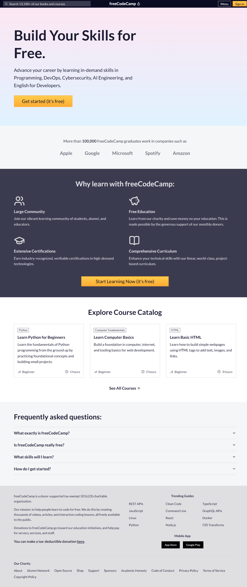
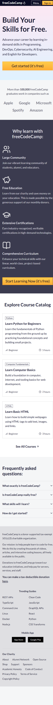
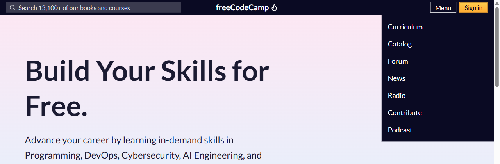
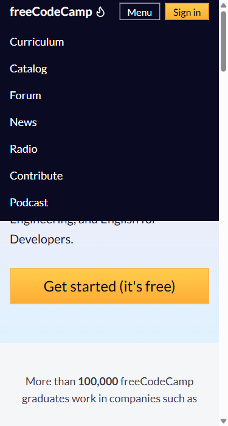
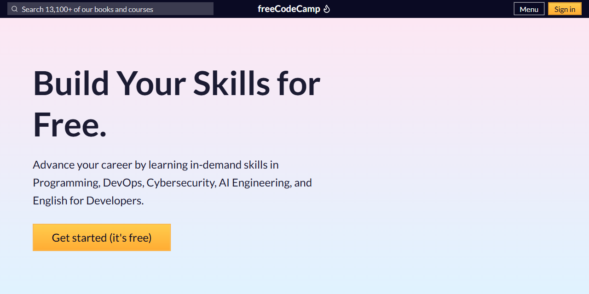
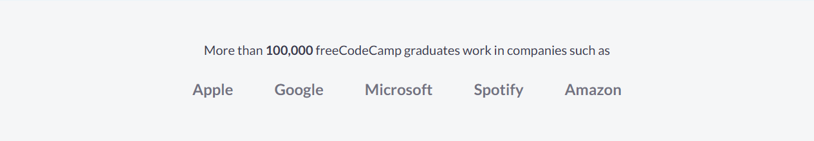
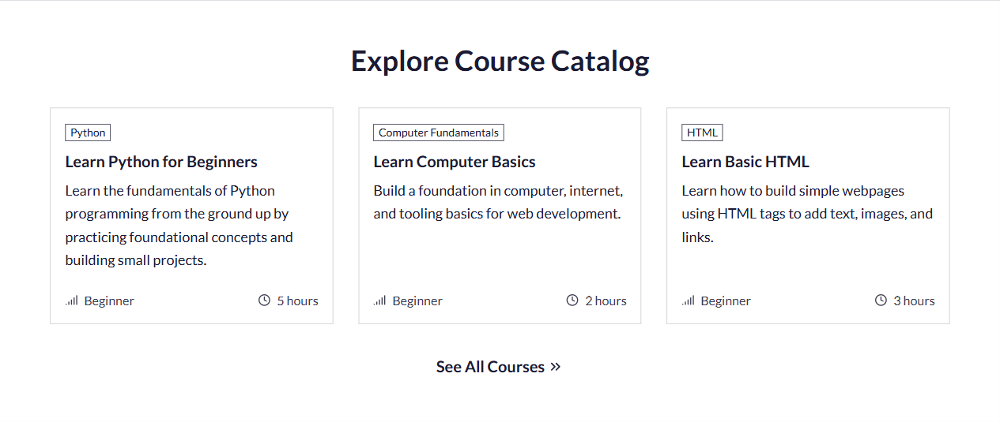
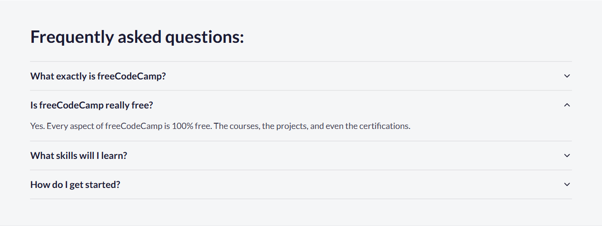
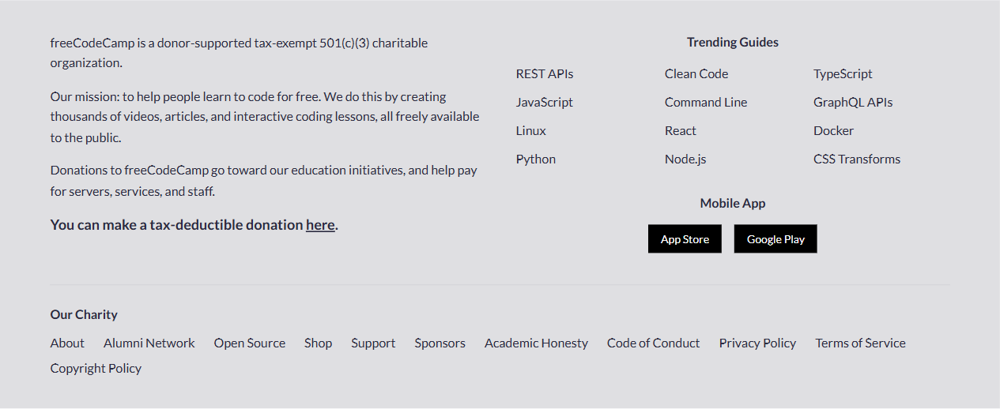
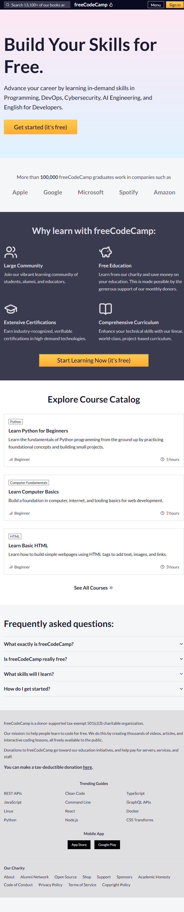

# Workshop Slicing freeCodeCamp dengan Next.js

Panduan *hands-on* untuk workshop front end staff muda. Kita akan meniru (*slicing*) tampilan halaman utama [freecodecamp.org](https://www.freecodecamp.org/), yaitu navbar, sebagian konten, dan footer, memakai **Next.js + React + TypeScript + Tailwind CSS**.

*Slicing* artinya mengubah sebuah desain atau tampilan web menjadi kode HTML/CSS/komponen yang hasilnya mirip aslinya.

> **Catatan:** Proyek ini hanya untuk latihan belajar slicing dan tidak berafiliasi dengan freeCodeCamp. Logo dan foto asli tidak digunakan.

## Hasil Akhir

| Laptop (1280px) | HP (375px) |
| --- | --- |
|  |  |

Tampilan tablet (768px) ada di [docs/images/hasil-akhir-768.png](docs/images/hasil-akhir-768.png). Kunci jawaban (project lengkap yang sudah jadi) ada di folder [`hasil-akhir/`](hasil-akhir/).

## Prasyarat

- Laptop dengan Windows, macOS, atau Linux (panduan ini memakai contoh Windows).
- Koneksi internet (untuk install tools dan package).
- Sudah tahu dasar HTML dan CSS. Pengalaman React **tidak wajib**, semua konsep dijelaskan saat dipakai.
- Akun GitHub (hanya untuk Tahap 12, bonus).

## Estimasi Waktu

| Tahap | Isi | Waktu |
| --- | --- | --- |
| 0 | Persiapan tools | 20 menit |
| 1 | Membuat project Next.js | 15 menit |
| 2 | Kenalan dengan struktur folder | 10 menit |
| 3 | Setup tema | 15 menit |
| 4 | Navbar | 25 menit |
| 5 | Hero | 10 menit |
| 6 | Deretan perusahaan | 10 menit |
| 7 | Why learn | 15 menit |
| 8 | Course Catalog | 25 menit |
| 9 | FAQ | 20 menit |
| 10 | Footer | 20 menit |
| 11 | Cek responsive, lint, build | 15 menit |
| 12 | Upload ke GitHub (bonus) | 15 menit |
| | **Total** | **± 3,5 jam** |

## Daftar Isi

- [Tahap 0 — Persiapan](#tahap-0--persiapan)
- [Tahap 1 — Membuat project Next.js](#tahap-1--membuat-project-nextjs)
- [Tahap 2 — Kenalan dengan struktur folder](#tahap-2--kenalan-dengan-struktur-folder)
- [Tahap 3 — Setup tema](#tahap-3--setup-tema)
- [Tahap 4 — Slicing Navbar](#tahap-4--slicing-navbar)
- [Tahap 5 — Slicing Hero](#tahap-5--slicing-hero)
- [Tahap 6 — Slicing deretan perusahaan alumni](#tahap-6--slicing-deretan-perusahaan-alumni)
- [Tahap 7 — Slicing "Why learn with freeCodeCamp"](#tahap-7--slicing-why-learn-with-freecodecamp)
- [Tahap 8 — Slicing Course Catalog](#tahap-8--slicing-course-catalog)
- [Tahap 9 — Slicing FAQ](#tahap-9--slicing-faq)
- [Tahap 10 — Slicing Footer](#tahap-10--slicing-footer)
- [Tahap 11 — Menyusun halaman, cek responsive, lint, dan build](#tahap-11--menyusun-halaman-cek-responsive-lint-dan-build)
- [Tahap 12 (bonus) — Upload project ke GitHub](#tahap-12-bonus--upload-project-ke-github)
- [Masalah yang sering muncul](#masalah-yang-sering-muncul)

---

## Tahap 0 — Persiapan

Kita butuh 3 tools. Kalau sudah punya, cukup cek versinya.

### 0.1 Node.js

**Node.js** adalah program untuk menjalankan JavaScript di luar browser. Next.js butuh Node.js untuk menjalankan server pengembangan dan membangun website. Saat install Node.js, kamu otomatis juga mendapat **npm** (*Node Package Manager*), yaitu alat untuk mengunduh *package* (kode siap pakai buatan orang lain).

1. Buka https://nodejs.org/en/download.
2. Pilih versi **LTS** (*Long Term Support*, versi paling stabil). Next.js versi sekarang butuh **minimal Node.js 20.9**.
3. Unduh installer untuk sistem operasimu, lalu jalankan. Klik **Next** terus sampai selesai (pengaturan bawaan sudah benar).
4. **Tutup lalu buka lagi** terminal atau VS Code supaya Node.js terdeteksi.

Cek apakah berhasil. Buka **PowerShell** (tekan tombol Windows, ketik `powershell`, Enter), lalu ketik:

```bash
node -v
```

```bash
npm -v
```

Yang seharusnya terlihat: angka versi, misalnya `v24.14.0` dan `11.16.0`. Angkamu boleh berbeda, yang penting `node -v` minimal `v20.9.0`.

### 0.2 Git

**Git** adalah alat untuk mencatat riwayat perubahan kode (*version control*). Kita pakai di Tahap 12 untuk mengunggah project ke GitHub.

1. Buka https://git-scm.com/downloads, unduh installer untuk sistem operasimu.
2. Jalankan installer. Pengaturan bawaan sudah aman, klik **Next** sampai selesai.
3. Cek di terminal:

```bash
git --version
```

Yang seharusnya terlihat: `git version 2.xx.x` (angka boleh berbeda).

> **macOS:** Git biasanya sudah ada. Kalau belum, menjalankan `git --version` akan menawarkan instalasi otomatis.

### 0.3 VS Code dan ekstensinya

**VS Code** adalah *code editor*, tempat kita menulis kode. Unduh di https://code.visualstudio.com/ lalu install. Di Windows, pastikan opsi **"Add to PATH"** tercentang (bawaannya sudah tercentang) supaya perintah `code .` bisa dipakai.

Pasang 2 ekstensi. Klik ikon **Extensions** di sidebar kiri (ikon 4 kotak) atau tekan `Ctrl + Shift + X`, lalu cari dan klik **Install**:

| Ekstensi | Fungsinya |
| --- | --- |
| **Tailwind CSS IntelliSense** (pembuat: Tailwind Labs) | Memberi saran nama kelas Tailwind saat mengetik, dan menampilkan CSS aslinya saat kursor diarahkan ke kelas. |
| **ES7+ React/Redux/React-Native snippets** (pembuat: dsznajder) | Menyediakan singkatan kode. Contoh: ketik `rafce` lalu Enter untuk membuat kerangka komponen React. |

### 0.4 Membuka terminal di VS Code

Sepanjang panduan ini, "terminal" artinya **terminal di dalam VS Code**. Cara membukanya: menu **Terminal → New Terminal**, atau tekan ``Ctrl + ` `` (tombol backtick, di kiri angka 1). Terminal muncul di bagian bawah VS Code. Di Windows, terminal bawaannya adalah **PowerShell**.

---

## Tahap 1 — Membuat project Next.js

**Next.js** adalah *framework* (kerangka kerja) di atas **React**. React adalah *library* untuk membuat tampilan dari potongan-potongan kecil bernama **komponen**. Next.js menambahkan hal-hal yang dibutuhkan website sungguhan: sistem halaman (*routing*), optimasi font dan gambar, dan proses *build* untuk dipublikasikan.

### 1.1 Pindah ke folder tempat menyimpan project

Buka VS Code, buka terminal (``Ctrl + ` ``), lalu pindah ke folder Documents:

```bash
cd $HOME\Documents
```

> **macOS/Linux:** pakai `cd ~/Documents`.

Kamu boleh memilih folder lain. Hindari folder yang namanya mengandung spasi atau tanda kurung, karena kadang membuat tools bingung.

### 1.2 Jalankan create-next-app

```bash
npx create-next-app@latest fcc-clone
```

Penjelasan perintah:

- `npx` menjalankan sebuah package tanpa perlu meng-install-nya permanen.
- `create-next-app@latest` adalah pembuat project Next.js resmi, versi terbaru.
- `fcc-clone` adalah nama folder project yang akan dibuat.

Pertanyaan yang muncul, berurutan:

**Pertanyaan 1** (hanya muncul jika create-next-app belum pernah diunduh):

```text
Need to install the following packages:
create-next-app@16.4.5
Ok to proceed? (y)
```

Ketik `y` lalu Enter. (Angka versinya bisa sedikit berbeda.)

**Pertanyaan 2:**

```text
? Would you like to use the recommended Next.js defaults? » - Use arrow-keys. Return to submit.
>   Yes, use recommended defaults - TypeScript, ESLint, No React Compiler, Tailwind CSS, No src/ directory, App Router, Cache Components, AGENTS.md, Agent feedback
    No, customize settings
```

Pilih **Yes, use recommended defaults** (sudah terpilih, cukup tekan **Enter**).

> Kalau kamu pernah memakai create-next-app sebelumnya, mungkin ada pilihan ketiga **"No, reuse previous settings"**. Jangan pilih itu. Tetap pilih **Yes, use recommended defaults**.

Isi dari "recommended defaults":

| Pengaturan | Artinya |
| --- | --- |
| TypeScript | Kode ditulis dengan **TypeScript**, yaitu JavaScript yang ditambah *type* (keterangan jenis data). Kesalahan bisa ketahuan sebelum kode dijalankan. File komponen berakhiran `.tsx`. |
| ESLint | Alat yang memeriksa kode dan memberi peringatan kalau ada pola yang salah. Dijalankan dengan `npm run lint`. |
| No React Compiler | Fitur optimasi otomatis React tidak diaktifkan. Kita tidak membutuhkannya. |
| Tailwind CSS | Framework CSS berbasis kelas utilitas, misalnya `text-center` atau `bg-white`. Versi yang dipakai adalah **Tailwind CSS v4**. |
| No src/ directory | Folder `app/` langsung berada di root project, tidak di dalam `src/`. |
| App Router | Sistem halaman Next.js modern: setiap folder di dalam `app/` menjadi alamat halaman. |
| Cache Components | Fitur caching Next.js. Tidak mengubah apa pun di workshop ini. |
| AGENTS.md | File petunjuk untuk asisten AI coding. Boleh diabaikan. |
| Agent feedback | Mengizinkan asisten AI coding menyiapkan masukan anonim untuk tim Next.js, yang kamu tinjau dulu sebelum dikirim. Tidak berpengaruh ke website kita. Bisa dimatikan dengan `experimental.agentFeedback: false` di `next.config.ts`. |

Selain itu ada **import alias `@/*`**: kita bisa menulis `@/components/Navbar` alih-alih `../../components/Navbar`. Tanda `@` artinya "mulai dari root project".

<details>
<summary>Kalau kamu tidak sengaja memilih "No, customize settings"</summary>

Jawab pertanyaan berikut supaya hasilnya sama dengan recommended defaults:

| Pertanyaan | Jawaban |
| --- | --- |
| Would you like to use TypeScript? | Yes |
| Which linter would you like to use? | ESLint |
| Would you like to use React Compiler? | No |
| Would you like to use Tailwind CSS? | Yes |
| Would you like your code inside a `src/` directory? | No |
| Would you like to use App Router? (recommended) | Yes |
| Would you like to use Cache Components? | Yes |
| Would you like to customize the import alias (`@/*` by default)? | No |
| Would you like to include AGENTS.md ...? | Yes |
| Would you like to help improve Next.js ... anonymized feedback ...? | Bebas (Yes atau No) |

</details>

Setelah itu create-next-app mengunduh package selama 1–5 menit, tergantung internet. Kalau berhasil, bagian akhirnya kira-kira seperti ini:

```text
Initialized a git repository.

Success! Created fcc-clone at C:\Users\namakamu\Documents\fcc-clone
```

Peringatan kuning seperti `npm warn deprecated ...` atau `8 moderate severity vulnerabilities` **boleh diabaikan**. Itu bukan error.

### 1.3 Buka project di VS Code

Masih di terminal yang sama:

```bash
cd fcc-clone
```

```bash
code .
```

`cd fcc-clone` memindahkan terminal ke folder project. `code .` membuka folder saat ini (`.` artinya "folder ini") di jendela VS Code baru. Mulai sekarang, kerjakan semuanya di **jendela VS Code yang baru** ini. Jendela lama boleh ditutup.

> Kalau `code .` tidak dikenali: di VS Code pilih **File → Open Folder...** lalu pilih folder `fcc-clone`. Di macOS, aktifkan dulu lewat `Cmd + Shift + P` → **Shell Command: Install 'code' command in PATH**.

### 1.4 Jalankan server pengembangan

Buka terminal di jendela VS Code yang baru (``Ctrl + ` ``). Pastikan terminal berada di folder `fcc-clone` (tulisan sebelum kursor berakhiran `fcc-clone>`). Lalu jalankan:

```bash
npm run dev
```

Yang seharusnya terlihat:

```text
▲ Next.js 16.4.5 (Turbopack)
- Local:         http://localhost:3000
- Network:       http://192.168.x.x:3000
✓ Ready in 2000ms
```

Buka browser, kunjungi **http://localhost:3000**. Kamu akan melihat halaman contoh Next.js dengan tulisan *"To get started, edit the page.tsx file."*

**Server pengembangan** (*dev server*) adalah program yang menyajikan website di laptopmu. Selama ia berjalan, setiap kali file disimpan, browser otomatis menampilkan perubahan (*hot reload*).

**Cara menghentikan server:** klik terminal, tekan `Ctrl + C`. Kalau ditanya `Terminate batch job (Y/N)?`, ketik `Y` lalu Enter. Untuk menjalankannya lagi, ketik `npm run dev`.

> **Tips:** Biarkan `npm run dev` tetap berjalan selama workshop. Kalau butuh mengetik perintah lain (misalnya `npm install`), buka terminal kedua dengan tombol **+** di pojok kanan panel terminal.

---

## Tahap 2 — Kenalan dengan struktur folder

Lihat panel **Explorer** di kiri VS Code. Isinya kira-kira seperti ini:

```text
fcc-clone/
├── .next/              ← dibuat otomatis oleh Next.js
├── app/
│   ├── favicon.ico
│   ├── globals.css
│   ├── layout.tsx
│   └── page.tsx
├── node_modules/       ← dibuat otomatis oleh npm
├── public/
│   ├── file.svg
│   ├── globe.svg
│   ├── next.svg
│   ├── vercel.svg
│   └── window.svg
├── .gitignore
├── AGENTS.md
├── eslint.config.mjs
├── next-env.d.ts
├── next.config.ts
├── package-lock.json
├── package.json
├── README.md
└── tsconfig.json
```

| File/Folder | Fungsinya |
| --- | --- |
| `app/` | Folder utama App Router. Setiap folder di dalamnya menjadi halaman. |
| `app/page.tsx` | Isi halaman utama (`/`, yaitu http://localhost:3000). **File yang paling sering kita ubah.** |
| `app/layout.tsx` | Kerangka yang membungkus semua halaman: tag `<html>`, `<body>`, font, dan judul tab browser. |
| `app/globals.css` | CSS global. Di sinilah Tailwind dimuat dan warna tema didaftarkan. |
| `app/favicon.ico` | Ikon kecil di tab browser. |
| `public/` | Tempat file statis (gambar, ikon). File `public/next.svg` bisa diakses lewat `/next.svg`. Kita tidak memakai file bawaannya, jadi boleh dihapus. |
| `package.json` | Daftar package yang dipakai project dan daftar perintah (`dev`, `build`, `start`, `lint`). |
| `package-lock.json` | Catatan versi persis setiap package. Dibuat otomatis, jangan diedit manual. |
| `node_modules/` | Isi semua package yang diunduh. Sangat besar, jangan diedit dan jangan di-upload ke GitHub. |
| `.next/` | Hasil olahan Next.js. Dibuat otomatis, boleh dihapus kalau ada masalah aneh. |
| `next.config.ts` | Pengaturan Next.js. Di versi ini, Tailwind juga disambungkan lewat file ini. Tidak perlu diubah. |
| `tsconfig.json` | Pengaturan TypeScript, termasuk alias `@/*`. |
| `eslint.config.mjs` | Pengaturan ESLint. |
| `next-env.d.ts` | File type bawaan Next.js. Dibuat otomatis, jangan diedit. |
| `AGENTS.md` | Petunjuk untuk asisten AI coding. Bisa diabaikan. |
| `.gitignore` | Daftar file/folder yang tidak ikut di-upload ke Git (misalnya `node_modules/` dan `.next/`). |

> **Tidak ada `tailwind.config.js`?** Benar. Tailwind CSS v4 tidak memakai file itu lagi. Semua pengaturan (warna, font) ditulis langsung di `app/globals.css` dengan `@theme`. Kalau kamu menemukan tutorial lain yang menyuruh membuat `tailwind.config.js`, itu tutorial untuk Tailwind v3.

### 2.1 Bersihkan `app/page.tsx`

Buka `app/page.tsx`, hapus semua isinya (`Ctrl + A` lalu `Delete`), lalu ganti dengan:

📄 `app/page.tsx`

<!-- file: app/page.tsx -->
```tsx
export default function Home() {
  return (
    <main className="p-8">
      <h1 className="text-3xl font-bold text-blue-600">Halo, Workshop!</h1>
      <p className="mt-2">
        Kalau judul di atas berwarna biru dan tebal, berarti Tailwind sudah
        berjalan.
      </p>
    </main>
  );
}
```

### 2.2 Bersihkan `app/globals.css`

Buka `app/globals.css`, hapus semua isinya, lalu ganti dengan satu baris ini:

📄 `app/globals.css`

<!-- file: app/globals.css -->
```css
@import "tailwindcss";
```

Baris ini memuat seluruh Tailwind CSS. Tanpa baris ini, kelas seperti `text-3xl` tidak akan berfungsi.

Simpan kedua file (`Ctrl + S`). Browser di http://localhost:3000 sekarang menampilkan tulisan **"Halo, Workshop!"** besar, tebal, berwarna biru di kiri atas.

> **Tips:** Aktifkan **File → Auto Save** di VS Code supaya file otomatis tersimpan.

---

## Tahap 3 — Setup tema

Di tahap ini kita menyiapkan "bahan dasar" yang dipakai semua komponen: font, warna, dan ikon.

### 3.1 Daftarkan warna dan font di `app/globals.css`

Ganti seluruh isi `app/globals.css` dengan:

📄 `app/globals.css`

<!-- file: app/globals.css -->
```css
@import "tailwindcss";

/* Semua token tema ditulis di sini. Tailwind otomatis membuat kelasnya,
   misalnya --color-fcc-navy menjadi bg-fcc-navy, text-fcc-navy, border-fcc-navy. */
@theme {
  /* Font utama: ambil dari variabel --font-lato yang dibuat di layout.tsx */
  --font-sans: var(--font-lato), ui-sans-serif, system-ui, sans-serif;

  /* Warna freeCodeCamp */
  --color-fcc-navy: #0a0a23; /* navbar, teks tombol kuning */
  --color-fcc-bg: #f5f6f7; /* latar halaman */
  --color-fcc-text: #1b1b32; /* teks utama */
  --color-fcc-gray: #3b3b4f; /* teks sekunder, latar section gelap */
  --color-fcc-light: #dfdfe2; /* teks terang & latar footer */
  --color-fcc-footer-text: #2a2a40; /* teks footer */
  --color-fcc-border: #d0d0d5; /* garis tepi kartu */
  --color-fcc-yellow: #feac32; /* border tombol kuning */
  --color-fcc-yellow-light: #fecc4c; /* gradien tombol (atas) */
  --color-fcc-yellow-dark: #ffac33; /* gradien tombol (bawah) */

  /* Lebar maksimum konten: menghasilkan kelas max-w-fcc */
  --container-fcc: 1170px;
}
```

Penjelasan:

- `@theme { ... }` adalah cara Tailwind v4 untuk menambah "kosakata" baru. Setiap variabel yang diawali `--color-` otomatis menjadi kelas warna. Contoh: `--color-fcc-navy` membuat kelas `bg-fcc-navy` (latar), `text-fcc-navy` (teks), `border-fcc-navy` (garis tepi), dan seterusnya.
- `--font-sans` mengganti font bawaan Tailwind menjadi Lato.
- `--container-fcc: 1170px` membuat kelas `max-w-fcc` (lebar maksimum 1170px), sama dengan lebar konten freecodecamp.org.

Palet warna yang kita pakai:

| Kelas Tailwind | Warna | Dipakai untuk |
| --- | --- | --- |
| `fcc-navy` | `#0a0a23` | Navbar, teks tombol kuning |
| `fcc-bg` | `#f5f6f7` | Latar halaman |
| `fcc-text` | `#1b1b32` | Teks utama |
| `fcc-gray` | `#3b3b4f` | Teks sekunder, latar section gelap, kolom pencarian |
| `fcc-light` | `#dfdfe2` | Teks terang di section gelap, latar footer |
| `fcc-footer-text` | `#2a2a40` | Teks footer |
| `fcc-border` | `#d0d0d5` | Garis tepi kartu |
| `fcc-yellow` | `#feac32` | Border tombol kuning |
| `fcc-yellow-light` → `fcc-yellow-dark` | `#fecc4c` → `#ffac33` | Gradien tombol kuning (atas → bawah) |

### 3.2 Pasang font Lato dan ubah judul tab di `app/layout.tsx`

Ganti seluruh isi `app/layout.tsx` dengan:

📄 `app/layout.tsx`

<!-- file: app/layout.tsx -->
```tsx
import type { Metadata } from "next";
import { Lato } from "next/font/google";
import "./globals.css";

// Lato bukan "variable font", jadi weight harus disebutkan satu per satu
const lato = Lato({
  variable: "--font-lato", // dipakai di globals.css
  subsets: ["latin"],
  weight: ["400", "700"],
});

export const metadata: Metadata = {
  title: "freeCodeCamp Clone",
  description: "Latihan slicing halaman utama freeCodeCamp dengan Next.js",
};

export default function RootLayout({ children }: LayoutProps<"/">) {
  return (
    <html lang="en" className={`${lato.variable} h-full antialiased`}>
      <body className="flex min-h-full flex-col bg-fcc-bg text-fcc-text">
        {children}
      </body>
    </html>
  );
}
```

Penjelasan:

- `next/font/google` mengunduh font dari Google Fonts **saat build**, lalu menyajikannya dari website kita sendiri. Hasilnya lebih cepat dan tidak ada tampilan "loncat" saat font dimuat.
- `weight: ["400", "700"]` artinya kita memakai ketebalan normal (400) dan tebal (700). Lato wajib menyebutkan weight karena bukan *variable font*.
- `variable: "--font-lato"` membuat variabel CSS `--font-lato`. Variabel ini dipasang ke tag `<html>` lewat `lato.variable`, lalu dibaca oleh `--font-sans` di `globals.css`.
- `metadata` mengatur judul di tab browser. Sekarang judulnya **freeCodeCamp Clone**.
- `bg-fcc-bg text-fcc-text` di `<body>` memberi latar abu-abu muda dan warna teks utama ke seluruh halaman.
- `LayoutProps<"/">` adalah *type* bawaan Next.js untuk props layout. Kita tidak perlu membuatnya sendiri.

### 3.3 Install lucide-react

**lucide-react** adalah kumpulan ikon dalam bentuk komponen React. Di terminal (buka terminal kedua kalau `npm run dev` sedang berjalan), pastikan berada di folder `fcc-clone`, lalu jalankan:

```bash
npm install lucide-react
```

Yang seharusnya terlihat: `added 1 package, and audited ... packages`. Buka `package.json`, di bagian `"dependencies"` sekarang ada `"lucide-react"`.

`npm install nama-package` mengunduh package ke `node_modules/` dan mencatatnya di `package.json`. Teman yang meng-clone project-mu cukup menjalankan `npm install` (tanpa nama) untuk mengunduh semua package yang tercatat.

### 3.4 Cek hasil

Buka http://localhost:3000. Yang berubah:

- Judul tab browser menjadi **freeCodeCamp Clone**.
- Font berubah menjadi Lato (huruf sedikit lebih bulat).
- Latar halaman menjadi abu-abu sangat muda.

### Checkpoint

- Font tidak berubah? Cek `globals.css`: baris `--font-sans` harus memakai `var(--font-lato)` dan namanya harus sama persis dengan `variable: "--font-lato"` di `layout.tsx`.
- Judul tab tidak berubah? Simpan `layout.tsx`, lalu refresh browser (`Ctrl + R`).
- Error `Module not found: Can't resolve 'lucide-react'` nanti di Tahap 4? Berarti `npm install lucide-react` belum berhasil. Jalankan ulang di folder `fcc-clone`.

---

## Tahap 4 — Slicing Navbar

### Tujuan

Membuat komponen **`Navbar`**, yaitu bilah navigasi gelap di paling atas freecodecamp.org: ada kolom pencarian, logo di tengah, tombol **Menu**, dan tombol kuning **Sign in**. Klik **Menu** membuka daftar link.

### Bedah tampilan

```text
LAPTOP (≥ 768px)
┌──────────────────────────────────────────────────────────────────────┐
│ [🔍 Search 13,100+ ...      ]       freeCodeCamp 🔥      [Menu][Sign in]│  tinggi 38px
└──────────────────────────────────────────────────────────────────────┘
                                                         ┌─────────────┐
                                                         │ Curriculum  │  dropdown
                                                         │ Catalog ... │  (saat Menu diklik)
                                                         └─────────────┘
HP (< 768px)
┌────────────────────────────────────┐
│ freeCodeCamp 🔥      [Menu][Sign in]│   kolom pencarian disembunyikan
└────────────────────────────────────┘
┌────────────────────────────────────┐
│ Curriculum ...                     │   dropdown selebar layar
└────────────────────────────────────┘
```

- **Kotak luar:** latar `#0a0a23` (`fcc-navy`), teks putih, tinggi ±38px, menempel di atas saat halaman di-scroll.
- **Kiri:** kolom pencarian, latar `#3b3b4f`, tinggi 28px. **Disembunyikan di HP**, muncul mulai lebar 768px.
- **Tengah:** logo berupa teks tebal "freeCodeCamp" + ikon api.
- **Kanan:** tombol **Menu** (garis tepi putih tipis, latar gelap) dan tombol **Sign in** (gradien kuning, border 2px, sudut tidak membulat).
- **Dropdown:** muncul di bawah navbar, rata kanan. Lebar 288px di laptop, selebar layar di HP.

### Buat file

- Nama file: `Navbar.tsx`
- Lokasi lengkap: `components/Navbar.tsx` (folder `components` berada **di root project**, sejajar dengan `app/`, bukan di dalam `app/`)

Cara membuat:

1. Di panel Explorer, klik kanan area kosong di bawah daftar file (atau klik kanan nama project `FCC-CLONE`) → **New Folder...** → ketik `components` → Enter.
2. Klik kanan folder `components` → **New File...** → ketik `Navbar.tsx` → Enter.

Huruf besar-kecil nama file penting: tulis `Navbar.tsx`, bukan `navbar.tsx`.

### Kode lengkap

📄 `components/Navbar.tsx`

<!-- file: components/Navbar.tsx -->
```tsx
"use client"; // wajib, karena komponen ini memakai useState dan onClick

import { useState } from "react";
import { Flame, Search } from "lucide-react";

// Daftar link di dalam dropdown Menu
const menuLinks = [
  "Curriculum",
  "Catalog",
  "Forum",
  "News",
  "Radio",
  "Contribute",
  "Podcast",
];

export default function Navbar() {
  // isMenuOpen = apakah dropdown sedang terbuka (awalnya false/tertutup)
  const [isMenuOpen, setIsMenuOpen] = useState(false);

  return (
    <header className="sticky top-0 z-50 bg-fcc-navy text-white">
      <nav className="relative flex h-9.5 items-center justify-between gap-4 px-4">
        {/* KIRI: kolom pencarian, disembunyikan di HP, muncul mulai md */}
        <div className="hidden md:flex md:flex-1">
          <label className="flex h-7 w-full max-w-md items-center gap-2 bg-fcc-gray px-2">
            <Search className="size-4 text-fcc-light" aria-hidden="true" />
            <input
              type="search"
              placeholder="Search 13,100+ of our books and courses"
              className="w-full bg-transparent text-base text-white placeholder:text-fcc-light focus:outline-none"
            />
          </label>
        </div>

        {/* TENGAH: logo (teks + ikon api) */}
        <a href="#" className="flex items-center gap-1 text-xl font-bold">
          freeCodeCamp
          <Flame className="size-5" aria-hidden="true" />
        </a>

        {/* KANAN: tombol Menu dan Sign in */}
        <div className="flex items-center justify-end gap-2 md:flex-1">
          <button
            type="button"
            onClick={() => setIsMenuOpen(!isMenuOpen)}
            aria-expanded={isMenuOpen}
            className="h-7 border border-white px-3 text-base hover:bg-white hover:text-fcc-navy"
          >
            Menu
          </button>
          <a
            href="#"
            className="flex h-7 items-center border-2 border-fcc-yellow bg-linear-to-b from-fcc-yellow-light to-fcc-yellow-dark px-3 text-base text-fcc-navy"
          >
            Sign in
          </a>
        </div>

        {/* DROPDOWN: hanya dirender kalau isMenuOpen bernilai true */}
        {isMenuOpen && (
          <ul className="absolute top-full right-0 w-full bg-fcc-navy py-2 md:w-72">
            {menuLinks.map((link) => (
              <li key={link}>
                <a
                  href="#"
                  onClick={() => setIsMenuOpen(false)}
                  className="block px-4 py-2 text-lg hover:bg-fcc-gray"
                >
                  {link}
                </a>
              </li>
            ))}
          </ul>
        )}
      </nav>
    </header>
  );
}
```

### Penjelasan kode

**Konsep React/TypeScript:**

- **Komponen** adalah fungsi yang mengembalikan tampilan (JSX). Nama komponen wajib diawali huruf besar (`Navbar`). `export default` membuat komponen ini bisa di-*import* dari file lain.
- **JSX** adalah sintaks mirip HTML di dalam JavaScript. Bedanya: `class` ditulis `className`, dan kode JavaScript disisipkan dengan kurung kurawal `{ ... }`.
- **`useState`** adalah *hook* React untuk menyimpan data yang bisa berubah (*state*). `const [isMenuOpen, setIsMenuOpen] = useState(false)` artinya: buat state `isMenuOpen` dengan nilai awal `false`, dan `setIsMenuOpen` adalah fungsi untuk mengubahnya. Setiap kali state berubah, React menggambar ulang komponen.
- **`onClick`** adalah *event* yang dijalankan saat elemen diklik. `onClick={() => setIsMenuOpen(!isMenuOpen)}` membalik nilai: `false` jadi `true`, `true` jadi `false`. Tanda `!` artinya "kebalikan dari".
- **`"use client"`** wajib ditulis di baris paling atas file yang memakai `useState` atau event seperti `onClick`. Secara bawaan, komponen Next.js berjalan di server (*Server Component*) yang tidak bisa merespons klik. `"use client"` mengubahnya menjadi *Client Component* yang berjalan di browser.
- **`{isMenuOpen && ( ... )}`** artinya "tampilkan bagian ini hanya jika `isMenuOpen` bernilai `true`". Ini disebut *conditional rendering*.
- **`.map()`** mengubah setiap isi array menjadi elemen. `menuLinks.map((link) => <li ...>{link}</li>)` menghasilkan satu `<li>` untuk setiap nama link. Kita bahas lebih dalam di Tahap 8.
- **`key={link}`** wajib ada di elemen hasil `.map()`. Nilainya harus unik, supaya React bisa membedakan tiap item.
- **`aria-expanded`** dan **`aria-hidden`** adalah atribut aksesibilitas untuk pembaca layar. `aria-hidden="true"` menandai ikon sebagai hiasan saja.

**Kelas Tailwind penting:**

| Kelas | Artinya |
| --- | --- |
| `sticky top-0 z-50` | Navbar menempel di atas saat di-scroll, dan berada di lapisan paling depan. |
| `bg-fcc-navy text-white` | Latar `#0a0a23`, teks putih. |
| `flex items-center justify-between` | Isi disusun mendatar, di tengah secara vertikal, dengan jarak maksimal antara kiri dan kanan. |
| `h-9.5` | Tinggi 38px. Di Tailwind, 1 unit = 4px, jadi 9.5 × 4 = 38px. |
| `gap-4` / `gap-2` | Jarak antar-elemen 16px / 8px. |
| `px-4` | Padding kiri-kanan 16px. |
| `hidden md:flex` | Disembunyikan di HP, tampil (sebagai flex) mulai lebar 768px. |
| `md:flex-1` | Mulai 768px, kotak kiri dan kanan berbagi sisa ruang sama besar, sehingga logo pas di tengah. |
| `h-7` | Tinggi 28px (7 × 4). |
| `placeholder:text-fcc-light` | Warna teks placeholder di kolom pencarian. |
| `focus:outline-none` | Menghilangkan garis biru bawaan browser saat kolom diklik. |
| `size-4` / `size-5` | Lebar dan tinggi 16px / 20px (dipakai untuk ikon). |
| `border border-white` | Garis tepi 1px berwarna putih. |
| `hover:bg-white hover:text-fcc-navy` | Saat kursor di atas tombol, latar jadi putih dan teks jadi gelap. |
| `border-2 border-fcc-yellow` | Garis tepi 2px kuning. |
| `bg-linear-to-b from-fcc-yellow-light to-fcc-yellow-dark` | Gradien dari atas (`to-b` = *to bottom*) warna `#fecc4c` ke `#ffac33`. (Di Tailwind v3 namanya `bg-gradient-to-b`.) |
| `relative` + `absolute top-full right-0` | Dropdown diposisikan relatif terhadap `<nav>`: tepat di bawahnya (`top-full`) dan rata kanan (`right-0`). |
| `w-full md:w-72` | Dropdown selebar layar di HP, 288px mulai 768px. |
| `block px-4 py-2` | Link mengisi satu baris penuh, dengan padding supaya mudah diklik. |

**Mobile-first dan breakpoint.** Tailwind memakai pendekatan *mobile-first*: kelas tanpa awalan berlaku untuk **semua ukuran layar, mulai dari HP**. Kelas dengan awalan seperti `md:` hanya berlaku **mulai lebar tertentu ke atas**. Breakpoint yang kita pakai di workshop ini:

| Awalan | Berlaku mulai lebar | Kira-kira untuk |
| --- | --- | --- |
| *(tanpa awalan)* | 0px | HP |
| `md:` | 768px | Tablet |
| `lg:` | 1024px | Laptop |

Jadi `hidden md:flex` dibaca: "sembunyikan, tapi mulai 768px tampilkan sebagai flex".

### Pasang ke halaman

Ganti seluruh isi `app/page.tsx` dengan:

📄 `app/page.tsx`

<!-- file: app/page.tsx -->
```tsx
import Navbar from "@/components/Navbar";

export default function Home() {
  return (
    <>
      <Navbar />
      <main>{/* Konten halaman ditambahkan di tahap berikutnya */}</main>
    </>
  );
}
```

- `import Navbar from "@/components/Navbar";` mengambil komponen dari `components/Navbar.tsx`. Ekstensi `.tsx` tidak perlu ditulis.
- `<Navbar />` adalah cara memakai komponen, seperti tag HTML.
- `<> ... </>` disebut **Fragment**: pembungkus kosong. Komponen hanya boleh mengembalikan satu elemen induk, dan Fragment memenuhi aturan itu tanpa menambah tag di HTML.
- `{/* ... */}` adalah cara menulis komentar di dalam JSX.

### Cek hasil

Buka http://localhost:3000:

- **Laptop:** bilah gelap di atas. Kolom pencarian di kiri, "freeCodeCamp 🔥" di tengah, tombol Menu dan Sign in di kanan. Klik **Menu**: daftar 7 link muncul di kanan bawah. Klik lagi: daftar tertutup.
- **HP:** tekan `F12` → klik ikon HP/tablet (**Toggle device toolbar**, `Ctrl + Shift + M`) → pilih lebar 375. Kolom pencarian hilang, logo pindah ke kiri, dropdown selebar layar.





### Checkpoint

- Muncul error **"You're importing a module that depends on `useState` into a React Server Component module..."**? Baris `"use client";` harus berada di **baris pertama** `Navbar.tsx`, sebelum `import`.
- Muncul error **`Module not found: Can't resolve '@/components/Navbar'`**? Pastikan folder `components` ada di root project (bukan di dalam `app/`) dan nama file persis `Navbar.tsx`.
- Tombol Sign in tidak kuning, atau navbar tidak gelap? Cek `globals.css` dari Tahap 3: nama warna di `@theme` harus persis `--color-fcc-navy`, `--color-fcc-yellow`, dan seterusnya.

---

## Tahap 5 — Slicing Hero

### Tujuan

Membuat komponen **`Hero`**: bagian pembuka besar di bawah navbar, berisi judul "Build Your Skills for Free.", subjudul, dan tombol kuning besar "Get started (it's free)". Situs asli memakai foto di kanan; kita **tidak** memakai foto, hanya latar gradien lembut.

### Bedah tampilan

```text
┌───────────────────────────── latar gradien merah muda → biru muda ─────┐
│   ┌─ container 1170px ──────────────────────────────────────────────┐  │
│   │  Build Your Skills          ← judul tebal, 72px (HP: 48px)      │  │
│   │  for Free.                                                       │  │
│   │  Advance your career ...    ← subjudul 24px (HP: 20px)          │  │
│   │  [ Get started (it's free) ] ← tombol kuning                     │  │
│   └──────────────────────────────────────────────────────────────────┘  │
└────────────────────────────────────────────────────────────────────────┘
```

- **Kotak luar (`section`):** latar gradien dari merah muda (atas) ke biru muda (bawah), selebar layar.
- **Container:** lebar maksimum 1170px, di tengah, padding kiri-kanan 16px. Pola container ini dipakai di semua section berikutnya.
- **Isi:** rata kiri, lebar teks maksimum 672px supaya baris tidak terlalu panjang.
- **HP:** judul 48px, tombol **selebar layar**. **Laptop (≥ 768px):** judul 72px, tombol selebar isinya saja.

### Buat file

- Nama file: `Hero.tsx`
- Lokasi lengkap: `components/Hero.tsx`
- Cara membuat: klik kanan folder `components` → **New File...** → ketik `Hero.tsx` → Enter.

### Kode lengkap

📄 `components/Hero.tsx`

<!-- file: components/Hero.tsx -->
```tsx
export default function Hero() {
  return (
    <section className="bg-linear-to-b from-pink-100 to-sky-100">
      {/* Container: lebar maksimal 1170px, posisi di tengah */}
      <div className="mx-auto max-w-fcc px-4 py-16 md:py-24">
        <div className="max-w-2xl">
          <h1 className="text-5xl leading-tight font-bold md:text-7xl">
            Build Your Skills for Free.
          </h1>

          <p className="mt-6 text-xl leading-relaxed md:text-2xl">
            Advance your career by learning in-demand skills in Programming,
            DevOps, Cybersecurity, AI Engineering, and English for Developers.
          </p>

          {/* Tombol kuning: lebar penuh di HP, selebar isinya mulai md */}
          <a
            href="#"
            className="mt-8 block w-full border-2 border-fcc-yellow bg-linear-to-b from-fcc-yellow-light to-fcc-yellow-dark px-10 py-3 text-center text-2xl text-fcc-navy md:inline-block md:w-auto"
          >
            Get started (it&apos;s free)
          </a>
        </div>
      </div>
    </section>
  );
}
```

### Penjelasan kode

- Komponen ini **tidak** memakai `"use client"`, karena tidak ada `useState` atau `onClick`. Tanpa `"use client"`, komponen dirender di server: lebih ringan untuk browser.
- `&apos;` adalah kode HTML untuk tanda petik satu (`'`). ESLint di Next.js melarang menulis `'` langsung di teks JSX (aturan `react/no-unescaped-entities`), jadi `it's` ditulis `it&apos;s`. Di browser tetap tampil sebagai `it's`.

| Kelas | Artinya |
| --- | --- |
| `bg-linear-to-b from-pink-100 to-sky-100` | Gradien atas → bawah dari merah muda ke biru muda (warna bawaan Tailwind). |
| `mx-auto` | Margin kiri-kanan otomatis, membuat container berada di tengah. |
| `max-w-fcc` | Lebar maksimum 1170px (dari `--container-fcc` di `@theme`). |
| `py-16 md:py-24` | Padding atas-bawah 64px di HP, 96px mulai 768px. |
| `max-w-2xl` | Lebar maksimum 672px untuk blok teks. |
| `text-5xl md:text-7xl` | Ukuran judul 48px di HP, 72px mulai 768px. |
| `leading-tight` / `leading-relaxed` | Jarak antarbaris rapat (judul) / longgar (paragraf). |
| `font-bold` | Tebal (weight 700). |
| `mt-6`, `mt-8` | Margin atas 24px, 32px. |
| `text-xl md:text-2xl` | Subjudul 20px di HP, 24px mulai 768px. |
| `block w-full` | Di HP tombol menjadi blok selebar layar. |
| `md:inline-block md:w-auto` | Mulai 768px, tombol hanya selebar isinya. |
| `px-10 py-3 text-center text-2xl` | Padding 40px kiri-kanan dan 12px atas-bawah, teks di tengah, ukuran 24px. |

### Pasang ke halaman

Ganti seluruh isi `app/page.tsx` dengan:

📄 `app/page.tsx`

<!-- file: app/page.tsx -->
```tsx
import Navbar from "@/components/Navbar";
import Hero from "@/components/Hero";

export default function Home() {
  return (
    <>
      <Navbar />
      <main>
        <Hero />
      </main>
    </>
  );
}
```

### Cek hasil

- **Laptop:** judul besar dua baris, subjudul, dan tombol kuning di kiri, di atas latar gradien merah muda ke biru.
- **HP (375px):** judul lebih kecil (4 baris), tombol kuning memenuhi lebar layar.



### Checkpoint

- Konten menempel ke tepi kiri layar di laptop lebar? Pastikan ada `mx-auto max-w-fcc` di container dan `--container-fcc: 1170px;` ada di `@theme`.
- ESLint (garis merah) di kata `it's`? Ganti dengan `it&apos;s`.
- Tombol tidak melebar penuh di HP? Cek kelas `block w-full` (tanpa awalan) di tombol.

---

## Tahap 6 — Slicing deretan perusahaan alumni

### Tujuan

Membuat komponen **`Companies`**: kalimat "More than 100,000 freeCodeCamp graduates work in companies such as" lalu deretan nama perusahaan. Situs asli memakai logo; kita memakai **teks tebal abu-abu**.

### Bedah tampilan

```text
LAPTOP
        More than 100,000 freeCodeCamp graduates work in companies such as
           Apple     Google     Microsoft     Spotify     Amazon

HP
          More than 100,000 freeCodeCamp
          graduates work in companies such as
            Apple    Google    Microsoft
                 Spotify    Amazon          ← turun baris otomatis
```

- Latar mengikuti latar halaman (`#f5f6f7`), semua isi rata tengah.
- Kalimat 18px (laptop 20px), angka **100,000** tebal.
- Nama perusahaan: teks tebal 24px, abu-abu agak transparan, berjejer ke samping. Kalau tidak muat, turun ke baris berikutnya dengan rapi.

### Buat file

- Nama file: `Companies.tsx`
- Lokasi lengkap: `components/Companies.tsx`
- Cara membuat: klik kanan folder `components` → **New File...** → ketik `Companies.tsx` → Enter.

### Kode lengkap

📄 `components/Companies.tsx`

<!-- file: components/Companies.tsx -->
```tsx
// Nama perusahaan ditulis sebagai teks biasa (bukan logo asli)
const companies = ["Apple", "Google", "Microsoft", "Spotify", "Amazon"];

export default function Companies() {
  return (
    <section className="py-12 md:py-16">
      <div className="mx-auto max-w-fcc px-4 text-center">
        <p className="text-lg text-fcc-gray md:text-xl">
          More than <strong>100,000</strong> freeCodeCamp graduates work in
          companies such as
        </p>

        {/* flex-wrap: kalau tidak muat satu baris, turun ke baris berikutnya */}
        <ul className="mt-8 flex flex-wrap items-center justify-center gap-x-10 gap-y-4 md:gap-x-16">
          {companies.map((company) => (
            <li key={company} className="text-2xl font-bold text-fcc-gray/70">
              {company}
            </li>
          ))}
        </ul>
      </div>
    </section>
  );
}
```

### Penjelasan kode

- `companies` adalah **array** (daftar) berisi 5 teks. Array ditulis di luar fungsi komponen karena isinya tidak pernah berubah.
- `companies.map((company) => <li ...>{company}</li>)` membuat satu `<li>` untuk setiap nama. Kalau besok ada perusahaan baru, cukup tambah ke array.
- `<strong>` adalah tag HTML untuk teks tebal yang penting.

| Kelas | Artinya |
| --- | --- |
| `py-12 md:py-16` | Padding atas-bawah 48px di HP, 64px mulai 768px. |
| `text-center` | Teks rata tengah. |
| `text-lg md:text-xl` | 18px di HP, 20px mulai 768px. |
| `flex flex-wrap` | Item berjejer mendatar, dan **turun baris** kalau tidak muat. |
| `items-center justify-center` | Item di tengah, vertikal dan horizontal. |
| `gap-x-10 gap-y-4` | Jarak antar-item: 40px ke samping, 16px ke bawah. |
| `md:gap-x-16` | Jarak ke samping 64px mulai 768px. |
| `text-fcc-gray/70` | Warna `#3b3b4f` dengan opasitas 70% (agak transparan). |

### Pasang ke halaman

Ganti seluruh isi `app/page.tsx` dengan:

📄 `app/page.tsx`

<!-- file: app/page.tsx -->
```tsx
import Navbar from "@/components/Navbar";
import Hero from "@/components/Hero";
import Companies from "@/components/Companies";

export default function Home() {
  return (
    <>
      <Navbar />
      <main>
        <Hero />
        <Companies />
      </main>
    </>
  );
}
```

### Cek hasil

- **Laptop:** satu baris kalimat di tengah, di bawahnya 5 nama perusahaan sejajar.
- **HP (375px):** kalimat terbagi 2 baris, nama perusahaan terbagi 2 baris dan tetap di tengah.



### Checkpoint

- Nama perusahaan bertumpuk ke bawah satu per satu? Pastikan `<ul>` memakai `flex flex-wrap`.
- Ada peringatan **"Each child in a list should have a unique key prop"** di console browser? Tambahkan `key={company}` di `<li>`.
- Nama perusahaan terlalu menempel? Cek `gap-x-10`.

---

## Tahap 7 — Slicing "Why learn with freeCodeCamp"

### Tujuan

Membuat komponen **`WhyLearn`**: section berlatar gelap berisi judul "Why learn with freeCodeCamp:", 4 alasan (ikon + judul + deskripsi), dan tombol kuning "Start Learning Now (it's free)".

### Bedah tampilan

```text
┌──────────────────── latar #3b3b4f, teks #dfdfe2 ─────────────────────┐
│                  Why learn with freeCodeCamp:                        │
│                                                                      │
│  [ikon] Large Community          [ikon] Free Education               │  ← laptop: 2 kolom
│  Join our vibrant ...            Learn from our charity ...          │
│                                                                      │
│  [ikon] Extensive Certifications [ikon] Comprehensive Curriculum     │
│  Earn industry-recognized ...    Enhance your technical ...          │
│                                                                      │
│             [ Start Learning Now (it's free) ]                       │
└──────────────────────────────────────────────────────────────────────┘
HP: 4 item bertumpuk dalam 1 kolom, tombol selebar layar.
```

- Latar `#3b3b4f` (`fcc-gray`), teks terang `#dfdfe2` (`fcc-light`).
- Judul 36px di laptop (30px di HP), rata tengah.
- Grid 1 kolom di HP, 2 kolom mulai 768px.
- Setiap item: ikon 56px, judul tebal 20px, deskripsi 18px.
- Tombol: di tengah, lebar maksimum 448px.

### Buat file

- Nama file: `WhyLearn.tsx`
- Lokasi lengkap: `components/WhyLearn.tsx`
- Cara membuat: klik kanan folder `components` → **New File...** → ketik `WhyLearn.tsx` → Enter.

### Kode lengkap

📄 `components/WhyLearn.tsx`

<!-- file: components/WhyLearn.tsx -->
```tsx
import { BookOpen, GraduationCap, PiggyBank, Users } from "lucide-react";

// Setiap item punya ikon, judul, dan deskripsi
const benefits = [
  {
    icon: <Users className="size-14" aria-hidden="true" />,
    title: "Large Community",
    description:
      "Join our vibrant learning community of students, alumni, and educators.",
  },
  {
    icon: <PiggyBank className="size-14" aria-hidden="true" />,
    title: "Free Education",
    description:
      "Learn from our charity and save money on your education. This is made possible by the generous support of our monthly donors.",
  },
  {
    icon: <GraduationCap className="size-14" aria-hidden="true" />,
    title: "Extensive Certifications",
    description:
      "Earn industry-recognized, verifiable certifications in high-demand technologies.",
  },
  {
    icon: <BookOpen className="size-14" aria-hidden="true" />,
    title: "Comprehensive Curriculum",
    description:
      "Enhance your technical skills with our linear, world-class, project-based curriculum.",
  },
];

export default function WhyLearn() {
  return (
    <section className="bg-fcc-gray py-14 text-fcc-light">
      <div className="mx-auto max-w-fcc px-4">
        <h2 className="text-center text-3xl font-bold md:text-4xl">
          Why learn with freeCodeCamp:
        </h2>

        {/* Grid: 1 kolom di HP, 2 kolom mulai md */}
        <div className="mt-10 grid gap-10 md:grid-cols-2">
          {benefits.map((benefit) => (
            <div key={benefit.title}>
              {benefit.icon}
              <h3 className="mt-3 text-xl font-bold">{benefit.title}</h3>
              <p className="mt-2 text-lg leading-relaxed">
                {benefit.description}
              </p>
            </div>
          ))}
        </div>

        <a
          href="#"
          className="mx-auto mt-12 block w-full max-w-md border-2 border-fcc-yellow bg-linear-to-b from-fcc-yellow-light to-fcc-yellow-dark px-4 py-2 text-center text-2xl text-fcc-navy"
        >
          Start Learning Now (it&apos;s free)
        </a>
      </div>
    </section>
  );
}
```

### Penjelasan kode

- Ikon dari lucide-react dipakai seperti komponen biasa: `<Users />`. Ukurannya diatur dengan kelas `size-14`. Warnanya otomatis mengikuti warna teks (`currentColor`).
- Array `benefits` berisi **object**. Object adalah kumpulan data berpasangan `nama: nilai`, misalnya `title: "Large Community"`. Isi object diakses dengan titik: `benefit.title`.
- Properti `icon` menyimpan elemen JSX (`<Users ... />`), lalu ditampilkan dengan `{benefit.icon}`.
- `key={benefit.title}`: judul dipakai sebagai key karena setiap judul unik.

| Kelas | Artinya |
| --- | --- |
| `bg-fcc-gray text-fcc-light` | Latar `#3b3b4f`, teks `#dfdfe2`. |
| `py-14` | Padding atas-bawah 56px. |
| `text-3xl md:text-4xl` | Judul 30px di HP, 36px mulai 768px. |
| `grid gap-10` | Tata letak grid, jarak antar-item 40px. Tanpa jumlah kolom berarti 1 kolom. |
| `md:grid-cols-2` | 2 kolom mulai 768px. |
| `size-14` | Ikon 56 × 56px. |
| `mx-auto block w-full max-w-md` | Tombol berupa blok di tengah, lebar penuh tapi maksimum 448px. |

### Pasang ke halaman

Ganti seluruh isi `app/page.tsx` dengan:

📄 `app/page.tsx`

<!-- file: app/page.tsx -->
```tsx
import Navbar from "@/components/Navbar";
import Hero from "@/components/Hero";
import Companies from "@/components/Companies";
import WhyLearn from "@/components/WhyLearn";

export default function Home() {
  return (
    <>
      <Navbar />
      <main>
        <Hero />
        <Companies />
        <WhyLearn />
      </main>
    </>
  );
}
```

### Cek hasil

- **Laptop:** kotak gelap selebar layar, 4 item tersusun 2 × 2, tombol kuning di tengah bawah.
- **HP (375px):** 4 item tersusun ke bawah (1 kolom), tombol selebar layar.


### Checkpoint

- Ikon tidak muncul dan ada error `... is not exported from 'lucide-react'`? Cek ejaan nama ikon di baris `import` (huruf besar-kecil berpengaruh).
- Teks berwarna gelap di latar gelap? Pastikan `text-fcc-light` ada di `<section>`.
- Masih 1 kolom di laptop? Cek `md:grid-cols-2` dan pastikan lebar browser ≥ 768px.

---

## Tahap 8 — Slicing Course Catalog

### Tujuan

Membuat section **"Explore Course Catalog"** berisi 3 kartu kursus dan link "See All Courses". Di sini kita belajar konsep inti React: **data array + `.map()` + type TypeScript + komponen dengan props**. Kita membuat 2 komponen:

- **`CourseCard`**: satu kartu kursus (dipakai berulang kali).
- **`CourseCatalog`**: section yang berisi data kursus dan menyusun kartu-kartunya.

### Bedah tampilan

```text
                       Explore Course Catalog
┌──────────────────────┐ ┌──────────────────────┐ ┌──────────────────────┐
│ [Python]             │ │ [Computer Fundament.]│ │ [HTML]               │ ← label
│ Learn Python for ... │ │ Learn Computer Basics│ │ Learn Basic HTML     │ ← judul tebal
│ Learn the fundamen...│ │ Build a foundation...│ │ Learn how to build...│ ← deskripsi
│                      │ │                      │ │                      │
│ 📶 Beginner  🕒 5 hours│ │ 📶 Beginner 🕒 2 hours│ │ 📶 Beginner 🕒 3 hours│ ← level & durasi
└──────────────────────┘ └──────────────────────┘ └──────────────────────┘
                          See All Courses »
LAPTOP (≥ 1024px): 3 kolom.   HP dan tablet: 1 kolom (kartu bertumpuk).
```

- Section berlatar putih, judul 36px rata tengah.
- Kartu: latar putih, border 1px `#d0d0d5`, padding 18px, sudut kotak (tidak membulat).
- Di dalam kartu: label kategori (kotak bergaris tipis, teks kecil), judul tebal 20px, deskripsi 18px. Baris paling bawah: level di kiri, durasi di kanan.
- Isi tiga kartu sama strukturnya, hanya datanya yang berbeda. Inilah alasan kita membuat **satu** komponen kartu lalu mengisinya dengan data berbeda.

### Buat file

Ada 2 file:

| Nama file | Lokasi lengkap |
| --- | --- |
| `CourseCard.tsx` | `components/CourseCard.tsx` |
| `CourseCatalog.tsx` | `components/CourseCatalog.tsx` |

Cara membuat: klik kanan folder `components` → **New File...** → ketik nama file → Enter. Ulangi untuk file kedua.

### Kode lengkap

**File 1: `components/CourseCard.tsx`**

📄 `components/CourseCard.tsx`

<!-- file: components/CourseCard.tsx -->
```tsx
import { Clock, Signal } from "lucide-react";

// Type = "cetakan" bentuk data satu kursus.
// Di-export supaya bisa dipakai juga di CourseCatalog.tsx
export type Course = {
  category: string;
  title: string;
  description: string;
  level: string;
  duration: string;
};

// Props komponen ini bertipe Course, lalu langsung dibongkar (destructuring)
export default function CourseCard({
  category,
  title,
  description,
  level,
  duration,
}: Course) {
  return (
    <a
      href="#"
      className="flex flex-col justify-between gap-6 border border-fcc-border bg-white p-4.5 hover:border-fcc-gray"
    >
      {/* Bagian atas: label, judul, deskripsi */}
      <div>
        <span className="inline-block border border-fcc-gray px-1.5 text-sm">
          {category}
        </span>
        <h3 className="mt-3 text-xl font-bold">{title}</h3>
        <p className="mt-2 text-lg leading-relaxed">{description}</p>
      </div>

      {/* Bagian bawah: level di kiri, durasi di kanan */}
      <div className="flex items-center justify-between text-base text-fcc-gray">
        <span className="flex items-center gap-2">
          <Signal className="size-4" aria-hidden="true" />
          {level}
        </span>
        <span className="flex items-center gap-2">
          <Clock className="size-4" aria-hidden="true" />
          {duration}
        </span>
      </div>
    </a>
  );
}
```

**File 2: `components/CourseCatalog.tsx`**

📄 `components/CourseCatalog.tsx`

<!-- file: components/CourseCatalog.tsx -->
```tsx
import { ChevronsRight } from "lucide-react";
import CourseCard, { type Course } from "@/components/CourseCard";

// Data kursus. Course[] artinya "array berisi data bertipe Course"
const courses: Course[] = [
  {
    category: "Python",
    title: "Learn Python for Beginners",
    description:
      "Learn the fundamentals of Python programming from the ground up by practicing foundational concepts and building small projects.",
    level: "Beginner",
    duration: "5 hours",
  },
  {
    category: "Computer Fundamentals",
    title: "Learn Computer Basics",
    description:
      "Build a foundation in computer, internet, and tooling basics for web development.",
    level: "Beginner",
    duration: "2 hours",
  },
  {
    category: "HTML",
    title: "Learn Basic HTML",
    description:
      "Learn how to build simple webpages using HTML tags to add text, images, and links.",
    level: "Beginner",
    duration: "3 hours",
  },
];

export default function CourseCatalog() {
  return (
    <section className="bg-white py-14">
      <div className="mx-auto max-w-fcc px-4">
        <h2 className="text-center text-3xl font-bold md:text-4xl">
          Explore Course Catalog
        </h2>

        {/* Grid: 1 kolom di HP, 3 kolom mulai lg */}
        <div className="mt-10 grid gap-8 lg:grid-cols-3">
          {courses.map((course) => (
            <CourseCard
              key={course.title}
              category={course.category}
              title={course.title}
              description={course.description}
              level={course.level}
              duration={course.duration}
            />
          ))}
        </div>

        <div className="mt-10 text-center">
          <a
            href="#"
            className="inline-flex items-center gap-1 text-xl font-bold hover:underline"
          >
            See All Courses
            <ChevronsRight className="size-5" aria-hidden="true" />
          </a>
        </div>
      </div>
    </section>
  );
}
```

### Penjelasan kode

**Type.** `type Course = { ... }` mendefinisikan bentuk data satu kursus: harus punya `category`, `title`, `description`, `level`, dan `duration`, semuanya bertipe `string` (teks). Kalau ada yang lupa diisi atau salah ketik nama, VS Code langsung memberi garis merah sebelum kode dijalankan. Inilah keuntungan TypeScript.

**Props.** *Props* (*properties*) adalah data yang dikirim dari komponen induk ke komponen anak, mirip atribut di HTML:

```tsx
<CourseCard title="Learn Basic HTML" level="Beginner" ... />
```

Di sisi `CourseCard`, props diterima sebagai parameter fungsi. `({ category, title, ... }: Course)` artinya: props bertipe `Course`, lalu langsung dibongkar menjadi variabel `category`, `title`, dan seterusnya (*destructuring*). Komponen yang sama bisa menampilkan data berbeda tergantung props-nya.

**Array + `.map()`.** `const courses: Course[] = [...]` adalah array berisi 3 object bertipe `Course`. `courses.map((course) => <CourseCard ... />)` menjalankan fungsi untuk setiap object dan menghasilkan 3 kartu. Untuk menambah kartu keempat, cukup tambah satu object ke array, tanpa menyalin kode JSX.

**`key`.** Elemen hasil `.map()` wajib punya `key` yang unik. Kita pakai `course.title`. `key` tidak dikirim sebagai props; ia hanya dipakai React untuk membedakan tiap item.

**`export type` dan `import { type Course }`.** `Course` di-*export* dari `CourseCard.tsx` supaya bisa dipakai juga di `CourseCatalog.tsx`. Perhatikan bedanya: `CourseCard` di-import tanpa kurung kurawal karena ia `export default`, sedangkan `Course` memakai kurung kurawal karena ia *named export* (export biasa).

| Kelas | Artinya |
| --- | --- |
| `flex flex-col justify-between` | Isi kartu disusun ke bawah; bagian atas dan bawah didorong ke ujung, jadi baris level/durasi selalu di dasar kartu. |
| `gap-6` | Jarak 24px antara bagian atas dan bawah kartu. |
| `border border-fcc-border` | Garis tepi 1px warna `#d0d0d5`. |
| `bg-white` | Latar putih. |
| `p-4.5` | Padding 18px (4.5 × 4) di semua sisi. |
| `hover:border-fcc-gray` | Garis tepi lebih gelap saat kursor di atas kartu. |
| `inline-block border px-1.5 text-sm` | Label kategori: kotak seukuran teks, garis tepi tipis, padding 6px, teks 14px. |
| `grid gap-8` | Grid 1 kolom, jarak 32px. |
| `lg:grid-cols-3` | 3 kolom mulai lebar 1024px (`lg`). |
| `inline-flex items-center gap-1` | Teks "See All Courses" dan ikon panah sejajar mendatar. |
| `hover:underline` | Garis bawah saat kursor di atas link. |

### Pasang ke halaman

`CourseCard` tidak perlu di-import di `page.tsx`, karena sudah dipakai di dalam `CourseCatalog`. Ganti seluruh isi `app/page.tsx` dengan:

📄 `app/page.tsx`

<!-- file: app/page.tsx -->
```tsx
import Navbar from "@/components/Navbar";
import Hero from "@/components/Hero";
import Companies from "@/components/Companies";
import WhyLearn from "@/components/WhyLearn";
import CourseCatalog from "@/components/CourseCatalog";

export default function Home() {
  return (
    <>
      <Navbar />
      <main>
        <Hero />
        <Companies />
        <WhyLearn />
        <CourseCatalog />
      </main>
    </>
  );
}
```

### Cek hasil

- **Laptop (≥ 1024px):** section putih dengan 3 kartu berdampingan, sama tinggi. Baris "Beginner" dan durasi berada di dasar setiap kartu. Di bawahnya link "See All Courses »".
- **Tablet (768px) dan HP (375px):** kartu bertumpuk 1 kolom, selebar container.



### Checkpoint

- Garis merah di `<CourseCard ... />` dengan pesan *"Property 'duration' is missing..."*? Ada props yang belum dikirim. Pastikan kelima props (`category`, `title`, `description`, `level`, `duration`) ditulis.
- Error *"'Course' is not exported"*? Pastikan di `CourseCard.tsx` tertulis `export type Course`, bukan `type Course` saja.
- Kartu tidak sama tinggi di laptop? Pastikan kartu memakai `flex flex-col justify-between` dan lebar browser ≥ 1024px.

---

## Tahap 9 — Slicing FAQ

### Tujuan

Membuat komponen **`Faq`**: judul "Frequently asked questions:" dan 4 pertanyaan berbentuk **accordion**. *Accordion* adalah daftar yang bisa dibuka-tutup: klik pertanyaan → jawaban muncul dan ikon panah berputar; klik lagi → jawaban hilang.

### Bedah tampilan

```text
Frequently asked questions:
──────────────────────────────────────────────────────────
What exactly is freeCodeCamp?                           ⌄
──────────────────────────────────────────────────────────
Is freeCodeCamp really free?                            ⌃   ← terbuka (panah berputar)
Yes. Every aspect of freeCodeCamp is 100% free. ...         ← jawaban muncul
──────────────────────────────────────────────────────────
What skills will I learn?                               ⌄
──────────────────────────────────────────────────────────
How do I get started?                                   ⌄
──────────────────────────────────────────────────────────
```

- Judul 36px (HP 30px), rata kiri.
- Setiap pertanyaan adalah tombol selebar container: teks tebal di kiri, ikon panah di kanan.
- Garis pemisah tipis `#d0d0d5` di antara pertanyaan.
- Hanya **satu** jawaban terbuka dalam satu waktu. Tampilan HP dan laptop sama; di HP teks pertanyaan sedikit lebih kecil.

### Buat file

- Nama file: `Faq.tsx`
- Lokasi lengkap: `components/Faq.tsx`
- Cara membuat: klik kanan folder `components` → **New File...** → ketik `Faq.tsx` → Enter.

### Kode lengkap

📄 `components/Faq.tsx`

<!-- file: components/Faq.tsx -->
```tsx
"use client"; // wajib, karena memakai useState dan onClick

import { useState } from "react";
import { ChevronDown } from "lucide-react";

type FaqItem = {
  question: string;
  answer: string;
};

const faqs: FaqItem[] = [
  {
    question: "What exactly is freeCodeCamp?",
    answer:
      "freeCodeCamp is a community of people from all around the world who are learning to code together. We're a 501(c)(3) public charity.",
  },
  {
    question: "Is freeCodeCamp really free?",
    answer:
      "Yes. Every aspect of freeCodeCamp is 100% free. The courses, the projects, and even the certifications.",
  },
  {
    question: "What skills will I learn?",
    answer:
      "You will learn the skills most developers use on the job: HTML, CSS, JavaScript, Python, Linux, Git, and SQL, and more.",
  },
  {
    question: "How do I get started?",
    answer:
      "If you're a beginner, you should start at the beginning of the freeCodeCamp core curriculum.",
  },
];

export default function Faq() {
  // Menyimpan nomor (index) pertanyaan yang sedang terbuka.
  // null = tidak ada yang terbuka.
  const [openIndex, setOpenIndex] = useState<number | null>(null);

  function handleToggle(index: number) {
    // Klik pertanyaan yang sama -> tutup. Klik pertanyaan lain -> buka yang itu.
    setOpenIndex(openIndex === index ? null : index);
  }

  return (
    <section className="py-14">
      <div className="mx-auto max-w-fcc px-4">
        <h2 className="text-3xl font-bold md:text-4xl">
          Frequently asked questions:
        </h2>

        <div className="mt-8 divide-y divide-fcc-border border-y border-fcc-border">
          {faqs.map((faq, index) => {
            const isOpen = openIndex === index;

            return (
              <div key={faq.question}>
                <button
                  type="button"
                  onClick={() => handleToggle(index)}
                  aria-expanded={isOpen}
                  className="flex w-full items-center justify-between gap-4 py-4 text-left text-lg font-bold md:text-xl"
                >
                  {faq.question}
                  {/* Ikon berputar 180 derajat saat terbuka */}
                  <ChevronDown
                    className={`size-5 shrink-0 transition-transform duration-200 ${
                      isOpen ? "rotate-180" : ""
                    }`}
                    aria-hidden="true"
                  />
                </button>

                {/* Jawaban hanya muncul kalau isOpen bernilai true */}
                {isOpen && (
                  <p className="pb-4 text-lg leading-relaxed text-fcc-gray">
                    {faq.answer}
                  </p>
                )}
              </div>
            );
          })}
        </div>
      </div>
    </section>
  );
}
```

### Penjelasan kode

- **`"use client"`** wajib, karena ada `useState` dan `onClick`.
- **`useState<number | null>(null)`**: state `openIndex` menyimpan **nomor urut** (index) pertanyaan yang terbuka. Index array dimulai dari 0, jadi pertanyaan pertama = 0, kedua = 1, dan seterusnya. Nilai awal `null` artinya belum ada yang terbuka. `<number | null>` adalah type TypeScript: "isinya boleh angka atau null".
- **`faqs.map((faq, index) => ...)`**: parameter kedua `.map()` adalah index item tersebut.
- **`const isOpen = openIndex === index;`**: bernilai `true` kalau pertanyaan ini yang sedang terbuka. `===` artinya "sama dengan".
- **`handleToggle(index)`** dipanggil saat tombol diklik. Isinya memakai operator *ternary* `kondisi ? A : B` ("jika kondisi benar pakai A, jika tidak pakai B"): kalau pertanyaan yang diklik sedang terbuka, tutup (`null`); kalau tidak, buka pertanyaan itu.
- **`{isOpen && <p>...</p>}`**: jawaban hanya dirender kalau `isOpen` bernilai `true`.
- **Kelas dinamis.** `` className={`... ${isOpen ? "rotate-180" : ""}`} `` memakai *template literal* (teks dengan tanda backtick). Kelas `rotate-180` hanya ditambahkan saat terbuka, sehingga ikon berputar. Tulis nama kelas Tailwind **utuh** seperti ini, jangan dirangkai dari potongan teks (misalnya `"rotate-" + angka`), karena Tailwind tidak akan menemukannya.

| Kelas | Artinya |
| --- | --- |
| `divide-y divide-fcc-border` | Garis pemisah horizontal di antara setiap anak elemen, warna `#d0d0d5`. |
| `border-y border-fcc-border` | Garis di atas dan bawah daftar. |
| `flex w-full items-center justify-between` | Tombol selebar penuh; teks di kiri, ikon di kanan. |
| `gap-4` | Jarak minimal 16px antara teks dan ikon. |
| `py-4` | Padding atas-bawah 16px. |
| `text-left` | Teks di tombol rata kiri (bawaan tombol adalah rata tengah). |
| `text-lg md:text-xl` | Pertanyaan 18px di HP, 20px mulai 768px. |
| `shrink-0` | Ikon tidak boleh mengecil walaupun teks pertanyaan panjang. |
| `transition-transform duration-200` | Putaran ikon dianimasikan selama 200 milidetik. |
| `rotate-180` | Memutar ikon 180 derajat. |
| `pb-4` | Padding bawah 16px untuk jawaban. |

### Pasang ke halaman

Ganti seluruh isi `app/page.tsx` dengan:

📄 `app/page.tsx`

<!-- file: app/page.tsx -->
```tsx
import Navbar from "@/components/Navbar";
import Hero from "@/components/Hero";
import Companies from "@/components/Companies";
import WhyLearn from "@/components/WhyLearn";
import CourseCatalog from "@/components/CourseCatalog";
import Faq from "@/components/Faq";

export default function Home() {
  return (
    <>
      <Navbar />
      <main>
        <Hero />
        <Companies />
        <WhyLearn />
        <CourseCatalog />
        <Faq />
      </main>
    </>
  );
}
```

### Cek hasil

- Semua pertanyaan awalnya tertutup.
- Klik "Is freeCodeCamp really free?": jawaban muncul dan panah berputar ke atas.
- Klik pertanyaan lain: jawaban sebelumnya tertutup, jawaban baru terbuka.
- Klik pertanyaan yang sedang terbuka: jawaban tertutup.
- Di HP (375px), pertanyaan panjang turun baris dan ikon tetap di kanan.



### Checkpoint

- Error **"You're importing a module that depends on `useState` into a React Server Component module..."**? Tambahkan `"use client";` di baris pertama `Faq.tsx`.
- Klik tidak berpengaruh? Pastikan `onClick={() => handleToggle(index)}` memakai `() =>`. Kalau ditulis `onClick={handleToggle(index)}`, fungsi langsung dijalankan saat render, bukan saat diklik.
- Ikon tidak berputar? Cek penulisan backtick dan `${ ... }` di `className` ikon.

---

## Tahap 10 — Slicing Footer

### Tujuan

Membuat komponen **`Footer`**: bagian paling bawah halaman berlatar abu-abu terang. Isinya: penjelasan singkat freeCodeCamp sebagai organisasi amal, daftar link "Trending Guides", "Mobile App", dan deretan link "Our Charity".

### Bedah tampilan

```text
LAPTOP (≥ 1024px)
┌──────────────────────── latar #dfdfe2, teks #2a2a40 ─────────────────────────┐
│ freeCodeCamp is a donor-supported ...  │          Trending Guides             │
│ Our mission: to help people ...        │  REST APIs   Clean Code  TypeScript  │
│ Donations to freeCodeCamp go ...       │  JavaScript  Command Line GraphQL... │
│ You can make a tax-deductible          │  ... (4 baris × 3 kolom)             │
│ donation here.  ← tebal                │            Mobile App                │
│                                        │      [App Store] [Google Play]       │
│──────────────────────────────────────────────────────────────────────────────│
│ Our Charity                                                                  │
│ About  Alumni Network  Open Source  Shop  Support  Sponsors  ...  (wrap)     │
└──────────────────────────────────────────────────────────────────────────────┘
HP: kolom kiri di atas, kolom kanan di bawahnya. Trending Guides jadi 2 kolom.
```

- Latar `#dfdfe2`, teks `#2a2a40`, ukuran teks 16px, padding atas-bawah 40px.
- Kolom kiri dan kanan **bertumpuk di HP**, **berdampingan mulai 1024px**.
- Grid link Trending Guides: **2 kolom di HP**, **3 kolom mulai 768px**.
- Baris bawah dipisah garis tipis. Link "Our Charity" berjejer ke samping dan turun baris kalau penuh.

### Buat file

- Nama file: `Footer.tsx`
- Lokasi lengkap: `components/Footer.tsx`
- Cara membuat: klik kanan folder `components` → **New File...** → ketik `Footer.tsx` → Enter.

### Kode lengkap

📄 `components/Footer.tsx`

<!-- file: components/Footer.tsx -->
```tsx
const trendingGuides = [
  "REST APIs",
  "Clean Code",
  "TypeScript",
  "JavaScript",
  "Command Line",
  "GraphQL APIs",
  "Linux",
  "React",
  "Docker",
  "Python",
  "Node.js",
  "CSS Transforms",
];

const charityLinks = [
  "About",
  "Alumni Network",
  "Open Source",
  "Shop",
  "Support",
  "Sponsors",
  "Academic Honesty",
  "Code of Conduct",
  "Privacy Policy",
  "Terms of Service",
  "Copyright Policy",
];

export default function Footer() {
  return (
    <footer className="bg-fcc-light py-10 text-base text-fcc-footer-text">
      <div className="mx-auto max-w-fcc px-4">
        {/* Dua kolom: bertumpuk di HP, berdampingan mulai lg */}
        <div className="grid gap-10 lg:grid-cols-2">
          {/* KOLOM KIRI: tentang freeCodeCamp */}
          <div className="space-y-4 leading-relaxed">
            <p>
              freeCodeCamp is a donor-supported tax-exempt 501(c)(3) charitable
              organization.
            </p>
            <p>
              Our mission: to help people learn to code for free. We do this by
              creating thousands of videos, articles, and interactive coding
              lessons, all freely available to the public.
            </p>
            <p>
              Donations to freeCodeCamp go toward our education initiatives,
              and help pay for servers, services, and staff.
            </p>
            <p className="text-lg font-bold">
              You can make a tax-deductible donation{" "}
              <a href="#" className="underline">
                here
              </a>
              .
            </p>
          </div>

          {/* KOLOM KANAN: Trending Guides + Mobile App */}
          <div>
            <h2 className="text-center font-bold">Trending Guides</h2>
            {/* Grid link: 2 kolom di HP, 3 kolom mulai md */}
            <ul className="mt-4 grid grid-cols-2 gap-x-4 gap-y-3 md:grid-cols-3">
              {trendingGuides.map((guide) => (
                <li key={guide}>
                  <a href="#" className="hover:underline">
                    {guide}
                  </a>
                </li>
              ))}
            </ul>

            <h2 className="mt-8 text-center font-bold">Mobile App</h2>
            <div className="mt-4 flex justify-center gap-4">
              <a href="#" className="bg-black px-4 py-2 text-sm text-white">
                App Store
              </a>
              <a href="#" className="bg-black px-4 py-2 text-sm text-white">
                Google Play
              </a>
            </div>
          </div>
        </div>

        {/* BARIS BAWAH: Our Charity */}
        <div className="mt-10 border-t border-fcc-border pt-6">
          <h2 className="font-bold">Our Charity</h2>
          {/* flex-wrap: link berjejer ke samping lalu turun kalau penuh */}
          <ul className="mt-3 flex flex-wrap gap-x-6 gap-y-2">
            {charityLinks.map((link) => (
              <li key={link}>
                <a href="#" className="hover:underline">
                  {link}
                </a>
              </li>
            ))}
          </ul>
        </div>
      </div>
    </footer>
  );
}
```

### Penjelasan kode

- Daftar link disimpan dalam array `trendingGuides` dan `charityLinks`, lalu dirender dengan `.map()`. Kode JSX-nya jadi pendek, dan menambah link cukup dengan menambah isi array.
- `{" "}` menyisipkan spasi. Di JSX, spasi di akhir baris sering hilang, jadi kita tulis eksplisit supaya "donation" dan "here" tidak menempel.
- `<footer>` adalah tag HTML semantik untuk bagian kaki halaman, sama seperti `<header>`, `<main>`, dan `<section>` yang sudah kita pakai.

| Kelas | Artinya |
| --- | --- |
| `bg-fcc-light text-fcc-footer-text` | Latar `#dfdfe2`, teks `#2a2a40`. |
| `py-10 text-base` | Padding atas-bawah 40px, teks 16px. |
| `grid gap-10 lg:grid-cols-2` | 1 kolom (bertumpuk) di HP dan tablet, 2 kolom mulai 1024px. |
| `space-y-4` | Jarak 16px di antara setiap paragraf (anak elemen). |
| `grid grid-cols-2 md:grid-cols-3` | Grid link: 2 kolom di HP, 3 kolom mulai 768px. |
| `gap-x-4 gap-y-3` | Jarak antar-link: 16px ke samping, 12px ke bawah. |
| `flex justify-center gap-4` | Dua tombol Mobile App di tengah, berjarak 16px. |
| `border-t border-fcc-border pt-6` | Garis pemisah di atas baris "Our Charity", lalu padding atas 24px. |
| `flex flex-wrap gap-x-6 gap-y-2` | Link "Our Charity" berjejer ke samping dan turun baris kalau penuh. |
| `underline` | Garis bawah permanen untuk link "here". |

### Pasang ke halaman

Footer diletakkan **di luar** `<main>`, karena footer bukan konten utama halaman. Ganti seluruh isi `app/page.tsx` dengan:

📄 `app/page.tsx`

<!-- file: app/page.tsx -->
```tsx
import Navbar from "@/components/Navbar";
import Hero from "@/components/Hero";
import Companies from "@/components/Companies";
import WhyLearn from "@/components/WhyLearn";
import CourseCatalog from "@/components/CourseCatalog";
import Faq from "@/components/Faq";
import Footer from "@/components/Footer";

export default function Home() {
  return (
    <>
      <Navbar />
      <main>
        <Hero />
        <Companies />
        <WhyLearn />
        <CourseCatalog />
        <Faq />
      </main>
      <Footer />
    </>
  );
}
```

### Cek hasil

- **Laptop (1280px):** footer abu-abu dengan 2 kolom. Kiri: 4 paragraf. Kanan: Trending Guides 3 kolom, lalu Mobile App. Di bawah garis: deretan link Our Charity.
- **Tablet (768px):** kolom kiri dan kanan bertumpuk, Trending Guides tetap 3 kolom.
- **HP (375px):** semua bertumpuk, Trending Guides 2 kolom, link Our Charity terbagi beberapa baris.



### Checkpoint

- Kalimat "donation" dan "here" menempel? Pastikan ada `{" "}` setelah kata `donation`.
- Trending Guides hanya 1 kolom di HP? Pastikan `grid-cols-2` ditulis **tanpa** awalan.
- Footer berada di tengah halaman, bukan di bawah? Pastikan `<Footer />` diletakkan setelah `</main>` di `page.tsx`.

---

## Tahap 11 — Menyusun halaman, cek responsive, lint, dan build

### 11.1 Susunan akhir `app/page.tsx`

Kalau kamu mengikuti setiap tahap, `app/page.tsx` sudah lengkap seperti di akhir Tahap 10. Bandingkan sekali lagi:

📄 `app/page.tsx`

<!-- file: app/page.tsx -->
```tsx
import Navbar from "@/components/Navbar";
import Hero from "@/components/Hero";
import Companies from "@/components/Companies";
import WhyLearn from "@/components/WhyLearn";
import CourseCatalog from "@/components/CourseCatalog";
import Faq from "@/components/Faq";
import Footer from "@/components/Footer";

export default function Home() {
  return (
    <>
      <Navbar />
      <main>
        <Hero />
        <Companies />
        <WhyLearn />
        <CourseCatalog />
        <Faq />
      </main>
      <Footer />
    </>
  );
}
```

Struktur folder akhirnya:

```text
fcc-clone/
├── app/
│   ├── favicon.ico
│   ├── globals.css
│   ├── layout.tsx
│   └── page.tsx
├── components/
│   ├── Companies.tsx
│   ├── CourseCard.tsx
│   ├── CourseCatalog.tsx
│   ├── Faq.tsx
│   ├── Footer.tsx
│   ├── Hero.tsx
│   ├── Navbar.tsx
│   └── WhyLearn.tsx
├── public/
└── ... (file konfigurasi lain)
```

### 11.2 Cek responsive di DevTools

**DevTools** adalah alat bawaan browser untuk memeriksa halaman.

1. Buka http://localhost:3000 di Chrome atau Edge.
2. Tekan `F12` (atau klik kanan → **Inspect**).
3. Klik ikon HP/tablet di kiri atas panel DevTools (**Toggle device toolbar**), atau tekan `Ctrl + Shift + M`.
4. Di bagian atas halaman, pilih **Dimensions: Responsive**, lalu ketik lebar dan tinggi. Cek 3 ukuran berikut:

| Lebar | Yang harus terlihat |
| --- | --- |
| **375px** (HP) | Kolom pencarian tersembunyi. Tombol "Get started" selebar layar. Why learn 1 kolom. Kartu kursus 1 kolom. Footer bertumpuk, Trending Guides 2 kolom. Tidak ada scroll ke samping. |
| **768px** (tablet) | Kolom pencarian muncul, logo di tengah. Why learn 2 kolom. Kartu kursus masih 1 kolom. Footer masih bertumpuk, Trending Guides 3 kolom. |
| **1280px** (laptop) | Konten dibatasi 1170px di tengah. Kartu kursus 3 kolom. Footer 2 kolom berdampingan. |

<p>



</p>

> **Cara cek "scroll ke samping":** di lebar 375px, coba geser halaman ke kanan. Kalau halaman bisa bergeser, berarti ada elemen yang terlalu lebar.

### 11.3 Jalankan lint

**Lint** memeriksa kode dari pola yang salah atau berisiko. Di terminal (folder `fcc-clone`):

```bash
npm run lint
```

Yang seharusnya terlihat: hanya dua baris berikut, tanpa pesan error atau warning.

```text
> fcc-clone@0.1.0 lint
> eslint
```

Kalau ada pesan, baca nama file dan nomor barisnya (misalnya `components/Hero.tsx  20:30  error ...`), lalu perbaiki baris tersebut.

### 11.4 Jalankan build

**Build** mengubah kode kita menjadi versi siap dipublikasikan: lebih kecil dan lebih cepat. Build juga memeriksa kesalahan TypeScript di semua file. Hentikan dulu `npm run dev` (`Ctrl + C`), lalu:

```bash
npm run build
```

Yang seharusnya terlihat di bagian akhir:

```text
✓ Compiled successfully in 3.7s
  Running TypeScript ...
  Finished TypeScript in 3.4s ...
✓ Generating static pages using 5 workers (4/4) in 1267ms

Route (app)
┌ ○ /
└ ○ /_not-found

○  (Static)  prerendered as static content
```

Angka waktunya boleh berbeda. Kalau berhasil, kamu bisa mencoba versi produksinya dengan:

```bash
npm run start
```

lalu buka http://localhost:3000. Hentikan dengan `Ctrl + C`, dan kembali ke `npm run dev` untuk lanjut mengedit.

---

## Tahap 12 (bonus) — Upload project ke GitHub

**GitHub** adalah situs untuk menyimpan repository Git secara online, jadi kode bisa dibagikan dan dipakai untuk portofolio.

### 12.1 Atur identitas Git (cukup sekali per laptop)

Kalau belum pernah, isi nama dan email (sama dengan email akun GitHub):

```bash
git config --global user.name "Nama Kamu"
```

```bash
git config --global user.email "emailkamu@example.com"
```

### 12.2 Commit perubahan

create-next-app sudah menjalankan `git init` dan membuat commit pertama (*"Initial commit from Create Next App"*). Kalau kamu membuat project dengan cara lain dan folder `.git` belum ada, jalankan `git init` dulu.

Di terminal (folder `fcc-clone`):

```bash
git add .
```

```bash
git commit -m "Slicing halaman utama freeCodeCamp"
```

- `git add .` memasukkan semua perubahan ke daftar yang akan dicatat. File di `.gitignore` (seperti `node_modules/` dan `.next/`) otomatis dilewati.
- `git commit -m "..."` mencatat perubahan itu dengan sebuah pesan.

Cek dengan `git log --oneline`. Yang seharusnya terlihat: 2 baris, commit pertama dari create-next-app dan commit-mu.

### 12.3 Buat repository di GitHub

1. Login ke https://github.com.
2. Klik tombol **+** di kanan atas → **New repository**.
3. Isi **Repository name**: `fcc-clone`. Pilih **Public**.
4. **Jangan** centang "Add a README file", ".gitignore", atau "license" (project kita sudah punya).
5. Klik **Create repository**.

### 12.4 Hubungkan dan push

GitHub menampilkan beberapa perintah. Jalankan yang ini (ganti `USERNAME` dengan username GitHub-mu):

```bash
git remote add origin https://github.com/USERNAME/fcc-clone.git
```

```bash
git branch -M main
```

```bash
git push -u origin main
```

- `git remote add origin ...` mendaftarkan alamat repository GitHub dengan nama `origin`.
- `git branch -M main` memastikan nama branch utama adalah `main`.
- `git push -u origin main` mengunggah commit ke GitHub.

Saat push pertama, jendela login GitHub mungkin muncul. Login lewat browser. Setelah selesai, refresh halaman repository di GitHub: file-file project-mu sudah ada di sana.

### 12.5 (Opsional) Deploy ke Vercel

**Vercel** adalah layanan hosting dari pembuat Next.js. Akun gratisnya cukup untuk project ini.

1. Buka https://vercel.com, pilih **Sign Up** → **Continue with GitHub**.
2. Klik **Add New... → Project**.
3. Pilih repository `fcc-clone` → **Import**.
4. Biarkan semua pengaturan bawaan (Vercel otomatis mengenali Next.js), klik **Deploy**.
5. Tunggu 1–2 menit. Kamu akan mendapat alamat seperti `https://fcc-clone-xxxx.vercel.app`.

Setiap kali kamu `git push` lagi, Vercel otomatis memperbarui website-nya.

---

## Masalah yang sering muncul

### Port 3000 sudah dipakai

Pesan: `⚠ Port 3000 is in use by process 12345, using available port 3001 instead.` (angka proses bisa berbeda, atau tertulis `by an unknown process`)

Artinya ada program lain (biasanya `npm run dev` lain yang lupa dihentikan) di port 3000. Next.js otomatis memakai port 3001; buka alamat yang tertulis di terminal. Untuk membereskannya:

- Cari terminal lain yang masih menjalankan `npm run dev`, lalu tekan `Ctrl + C` di sana. Cek juga tab terminal lain di VS Code.
- Atau hentikan prosesnya lewat PowerShell. Cari nomor PID (angka paling kanan):

```bash
netstat -ano | findstr :3000
```

lalu hentikan (ganti `12345` dengan PID-mu):

```bash
taskkill /PID 12345 /F
```

> **macOS/Linux:** `lsof -i :3000` untuk mencari PID, lalu `kill -9 12345`.

### `npx` / `npm` / `node` tidak dikenali

Pesan: `npx : The term 'npx' is not recognized ...`

- Node.js belum ter-install, atau terminal dibuka sebelum install. **Tutup VS Code sepenuhnya lalu buka lagi**. Kalau masih gagal, restart laptop.
- Cek dengan `node -v`. Kalau tetap tidak dikenali, install ulang Node.js dari https://nodejs.org.

Pesan lain yang sering muncul di Windows: `npx.ps1 cannot be loaded because running scripts is disabled on this system`. Ini karena PowerShell memblokir skrip. Pilih salah satu solusi:

- Ganti terminal ke **Command Prompt**: klik tanda panah **˅** di sebelah tombol **+** di panel terminal → **Command Prompt**. Lalu jalankan ulang perintahnya.
- Atau izinkan skrip untuk user-mu saja (cukup sekali), lalu buka ulang terminal:

```bash
Set-ExecutionPolicy -Scope CurrentUser RemoteSigned
```

### Kelas Tailwind tidak berpengaruh

- Pastikan baris pertama `app/globals.css` adalah `@import "tailwindcss";`.
- Pastikan `app/layout.tsx` punya `import "./globals.css";`.
- Cek ejaan kelas. Kelas yang salah ketik tidak menghasilkan error, hanya tidak berefek. Arahkan kursor ke kelas di VS Code: kalau Tailwind CSS IntelliSense tidak menampilkan CSS-nya, berarti nama kelasnya salah.
- Kelas warna custom (misalnya `bg-fcc-navy`) hanya ada kalau `--color-fcc-navy` tertulis di `@theme`.
- Tutorial lama memakai sintaks Tailwind v3. Contoh: v3 `bg-gradient-to-b`, v4 `bg-linear-to-b`.
- Jangan merangkai nama kelas dari potongan teks (`"text-" + warna`). Tulis nama kelas utuh.

### Error "useState only works in Client Components" (lupa `"use client"`)

Pesan yang muncul di browser atau terminal:

```text
./components/Faq.tsx:2:10
Error: You're importing a module that depends on `useState` into a React Server Component module. This API is only available in Client Components. To fix, mark the file (or its parent) with the `"use client"` directive.
```

Artinya: file ini memakai `useState` (atau `onClick`), padahal secara bawaan komponen Next.js adalah *Server Component*. Tambahkan baris berikut **di baris paling atas** file komponen tersebut, sebelum semua `import`:

```tsx
"use client";
```

Di project ini, yang butuh `"use client"` hanya `Navbar.tsx` dan `Faq.tsx`.

### Error import `@/components/...`

Pesan: `Module not found: Can't resolve '@/components/Navbar'`

- Folder `components` harus di **root project** (sejajar `app/`), bukan di `app/components/`.
- Nama file harus sama persis, termasuk huruf besar-kecil: `Navbar.tsx` ≠ `navbar.tsx`.
- Pastikan `tsconfig.json` masih punya `"paths": { "@/*": ["./*"] }`.
- Kalau semua sudah benar tapi VS Code masih memberi garis merah: tekan `Ctrl + Shift + P` → ketik **TypeScript: Restart TS Server** → Enter.

### Error ESLint `react/no-unescaped-entities`

Pesan saat `npm run lint`:

```text
components\Hero.tsx
  21:28  error  `'` can be escaped with `&apos;`, `&lsquo;`, `&#39;`, `&rsquo;`  react/no-unescaped-entities
```

Tanda petik satu (`'`) ditulis langsung di teks JSX. Ganti dengan `&apos;`, contoh: `it&apos;s`. Tanda petik di dalam string JavaScript (seperti di array FAQ) tidak bermasalah.

### Perubahan tidak muncul di browser

1. Pastikan file sudah disimpan (`Ctrl + S`). Tab file yang belum disimpan menampilkan titik bulat di samping namanya.
2. Pastikan `npm run dev` masih berjalan di terminal dan tidak ada pesan error.
3. Refresh paksa browser: `Ctrl + Shift + R`.
4. Hentikan server (`Ctrl + C`), lalu jalankan lagi `npm run dev`.
5. Masih belum? Hentikan server, hapus folder `.next`, lalu jalankan lagi:

```bash
Remove-Item -Recurse -Force .next
```

> **macOS/Linux:** `rm -rf .next`

```bash
npm run dev
```

---

Selamat, kamu sudah menyelesaikan slicing pertamamu dengan Next.js! Coba lanjutkan sendiri dengan menambah section lain dari freecodecamp.org, misalnya testimoni alumni atau daftar kurikulum.
